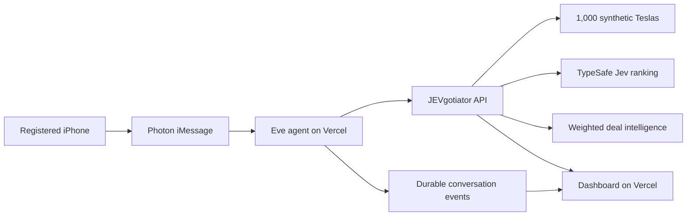

# JEVgotiator

Text an agent about a used Tesla in San Francisco and get five Jev-scored options
and a nonbinding deal plan. Built at the AI Collective x TypeSafe AI JEVathon
(September 26, 2026).

> **Status: Reference (hackathon project).** Built and demoed 2026-09-26; last
> push 2026-10-08. Deployments are still live; see Maintenance notes for
> post-event teardown.

Live site: **https://jevgotiator.vercel.app/** (landing page, recorded
side-by-side search comparison, and dashboard).

## What it does

1. A buyer texts **Eve** (an agent on Vercel, reached over Photon iMessage).
2. Eve clarifies the request into a typed brief (model, budget, max mileage,
   black exterior).
3. The JEVgotiator API applies hard filters to the catalog.
4. **TypeSafe Jev** scores the evidence for up to 30 eligible candidates and the
   buyer gets five options, each with a decision trace.
5. The buyer picks one to three cars; Dara's weighted rules produce a
   nonbinding deal plan (value 26%, evidence 23%, road-trip fit 18%, model fit
   8%, mileage/year/battery baseline 25%).
6. The web dashboard shows the same session: messages, observed tool calls,
   shortlist, and Jev trace.



### Measured comparison

For the same black Model 3 brief, an assisted public-browser search took over
four minutes and hit a human-verification wall. JEVgotiator filtered 1,000
synthetic records to 19 eligible cars and returned five Jev-scored results in
728 ms, using 8,167 Jev input tokens (about $0.0003). Different inventories, so
this compares workflow and instrumentation, not listing quality.

## How it fits with related repos

- `JEVathon` (private): pre-event planning workspace for the same hackathon.
  The planned concept there (a generic Jev-reranked search API) became this
  Tesla build.
- `jev-voice-proto` (private): a separate Jev prototype (voice -> decision ->
  action) from the same week.
- Jev is TypeSafe AI's System-One model for typed decisions; the
  `awesome-jev` list catalogs other public Jev projects.

## Team

- **Ben**: dashboard, clarification, hard filters, Jev ranking, integration,
  deployment.
- **Chris**: catalog consolidation and the Eve/Photon agent (`eve-agent/`).
- **Dara**: selected-car deal intelligence rules.

## Layout

```txt
app/                 Next.js 16 app: landing, dashboard, deal room components
app/api/v1/          search, clarify, listings, optimize, activity, health
app/api/session/     dashboard session
lib/                 contracts (zod), catalog, clarify, jev, dara-intelligence,
                     optimization, profile-match, activity, security
eve-agent/           Eve agent package (Photon iMessage + 3 tools), Node 24
data/catalog.json    deterministic synthetic catalog
scripts/             dev launcher, catalog generator, smoke test
tests/               node test runner suites (tsx)
docs/                integration contracts, demo walkthrough, design captures
examples/            early design fixtures (not current request shapes)
BUILD-SPEC.md        implemented architecture, routes, contracts, remaining work
railway.toml         reference only; Railway service settings are set remotely
```

## Run

Node.js 22 or 24.

```sh
npm ci
npm run dev          # http://localhost:3000 and /dashboard
npm test
npm run typecheck
npm run build && npm start
npm run seed:catalog # regenerate data/catalog.json
npm run seed:demo-activity # regenerate data/demo-activity.json (offline, synthetic)
```

Local development works without any provider credentials: synthetic inventory,
guided brief extraction, unscored search, and local deal planning. The dev
launcher creates a temporary session secret. With no `DEMO_ACCESS_CODE` set,
local development sessions are team sessions, so the Activity view reads the
live Eve feed when `EVE_AGENT_URL`/`EVE_API_KEY` are set.

## Public demo

Anyone can open the dashboard and try it. Visitors without the team code get a
**public** session:

- **Activity view** shows a recorded demo run (`data/demo-activity.json`):
  three fictional buyers texting Eve about a used Tesla, Eve clarifying, the
  search with Jev-ranked candidates from the synthetic catalog, the three tool
  calls, and a deal plan with opening messages. A banner says it is synthetic,
  and a Replay button plays the run step by step. Jev's answers in the replay
  are deterministic offline stand-ins, not a live model call.
- **Find a Tesla / Deal room** work as before against the bundled synthetic
  catalog (Jev ranking still runs when `TYPESAFE_API_KEY` is set).
- Public sessions never read the live Eve feed (no fallback), never use an
  external or MarketCheck catalog, never call the clarify model
  (`AI_GATEWAY_API_KEY`), and cannot request seller contact.

Entering the correct `DEMO_ACCESS_CODE` (on the sign-in screen or from the
replay banner's "Enter team access code") gives a **team** session with the
live Activity feed and configured providers. The tier is sealed into the
session cookie together with a fingerprint of the current code, so rotating
`DEMO_ACCESS_CODE` downgrades existing team sessions to public. Cookies issued
before this change carry no tier and are public. `INTEGRATION_API_KEY` bearer
clients (the Eve agent) keep full access.

## Config and secrets

Inject values from the vault or the host's environment settings.
[.env.example](.env.example) lists names only; never commit a populated `.env`.

| Variable | Purpose |
| --- | --- |
| `APP_SECRET` | Seals session cookies and result tokens (required in production) |
| `DEMO_ACCESS_CODE` | Team code. Only a correct code gives a team session (live Eve activity, model clarify, configured catalog, seller contact gate). Unset in production means no one is team |
| `OPEN_DEMO` | Default open: visitors without a code get a public session (synthetic replay and catalog). Set `false` to require the code for any session |
| `APP_ORIGIN` | Exact public origin for request-origin validation |
| `TYPESAFE_API_KEY` | Live Jev ranking (results are marked unscored without it) |
| `AI_GATEWAY_API_KEY`, `CLARIFY_MODEL` | Model-assisted brief extraction |
| `CATALOG_API_URL`, `CATALOG_API_KEY` | External inventory export |
| `MARKETCHECK_API_KEY` | Optional live dealer inventory (server-side only) |
| `DARA_API_URL`, `DARA_API_KEY` | Remote deal-intelligence jobs |
| `OUTBOUND_CONTACT_ENABLED` | Defaults false; seller contact is disabled. Even when true, only team sessions can request contact |
| `INTEGRATION_API_KEY` | Bearer access for trusted integration clients |
| `EVE_AGENT_URL`, `EVE_API_KEY` | Server-side access to the Eve activity feed |

Hosting: Vercel (dashboard and Eve agent) and Railway (API). Railway deploys
were triggered by explicit commit SHA; branch auto-deploy is unverified.

## Known gaps

- Inventory is synthetic; the MarketCheck credential tested during the event
  returned 401 and was not deployed.
- Jev scores at most 30 candidates per request.
- No application database, durable seller-job queue, or per-buyer backend auth.
- No purchase, payment, financing, signature, or title action exists. Final
  choice and JSON export are a handoff only.

## Maintenance notes

- **Post-event teardown:** the live Activity view is now team-only (by
  `DEMO_ACCESS_CODE`); visitors see the synthetic recorded replay, so
  `OPEN_DEMO` can stay open for a public demo. Make sure `DEMO_ACCESS_CODE` is
  set (and rotate it if it was shared at the event; rotation also revokes
  existing team sessions). Still rotate the hackathon `TYPESAFE_API_KEY` and
  Photon/Eve credentials (`EVE_API_KEY`), and decide whether to keep the
  Railway service (paid tier) running. Public search still spends Jev tokens
  while `TYPESAFE_API_KEY` is set.
- PR #2 (early spec and scraper plan) is stale; close it.
- Once deployments are torn down, archive the repo.
