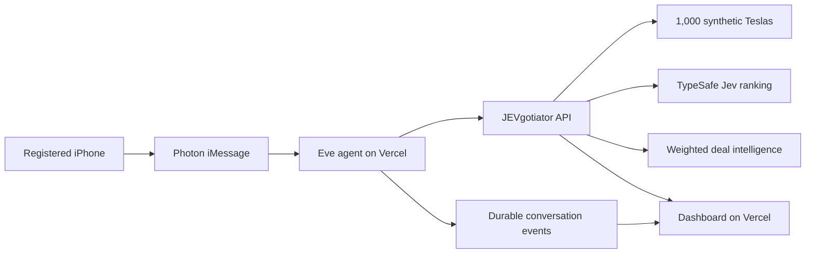

# JEVgotiator

Text an agent about a used Tesla in San Francisco and get five Jev-scored options
and a nonbinding deal plan. Built at the AI Collective x TypeSafe AI JEVathon
(September 26, 2026).

> **Status: Reference (hackathon project).** Built and demoed 2026-09-26; last
> push 2026-10-08. Deployments are still live; see Maintenance notes for
> post-event teardown.

Live site: **https://jevgotiator.vercel.app/** (landing page, recorded
side-by-side search comparison, and dashboard).

## What it does

1. A buyer texts **Eve** (an agent on Vercel, reached over Photon iMessage).
2. Eve clarifies the request into a typed brief (model, budget, max mileage,
   black exterior).
3. The JEVgotiator API applies hard filters to the catalog.
4. **TypeSafe Jev** scores the evidence for up to 30 eligible candidates and the
   buyer gets five options, each with a decision trace.
5. The buyer picks one to three cars; Dara's weighted rules produce a
   nonbinding deal plan (value 26%, evidence 23%, road-trip fit 18%, model fit
   8%, mileage/year/battery baseline 25%).
6. The web dashboard shows the same session: messages, observed tool calls,
   shortlist, and Jev trace.



### Measured comparison

For the same black Model 3 brief, an assisted public-browser search took over
four minutes and hit a human-verification wall. JEVgotiator filtered 1,000
synthetic records to 19 eligible cars and returned five Jev-scored results in
728 ms, using 8,167 Jev input tokens (about $0.0003). Different inventories, so
this compares workflow and instrumentation, not listing quality.

## How it fits with related repos

- `JEVathon` (private): pre-event planning workspace for the same hackathon.
  The planned concept there (a generic Jev-reranked search API) became this
  Tesla build.
- `jev-voice-proto` (private): a separate Jev prototype (voice -> decision ->
  action) from the same week.
- Jev is TypeSafe AI's System-One model for typed decisions; the
  `awesome-jev` list catalogs other public Jev projects.

## Team

- **Ben**: dashboard, clarification, hard filters, Jev ranking, integration,
  deployment.
- **Chris**: catalog consolidation and the Eve/Photon agent (`eve-agent/`).
- **Dara**: selected-car deal intelligence rules.

## Layout

```txt
app/                 Next.js 16 app: landing, dashboard, deal room components
app/api/v1/          search, clarify, listings, optimize, activity, health
app/api/session/     dashboard session
lib/                 contracts (zod), catalog, clarify, jev, dara-intelligence,
                     optimization, profile-match, activity, security
eve-agent/           Eve agent package (Photon iMessage + 3 tools), Node 24
data/catalog.json    deterministic synthetic catalog
scripts/             dev launcher, catalog generator, smoke test
tests/               node test runner suites (tsx)
docs/                integration contracts, demo walkthrough, design captures
examples/            early design fixtures (not current request shapes)
BUILD-SPEC.md        implemented architecture, routes, contracts, remaining work
railway.toml         reference only; Railway service settings are set remotely
```

## Run

Node.js 22 or 24.

```sh
npm ci
npm run dev          # http://localhost:3000 and /dashboard
npm test
npm run typecheck
npm run build && npm start
npm run seed:catalog # regenerate data/catalog.json
```

Local development works without any provider credentials: synthetic inventory,
guided brief extraction, unscored search, and local deal planning. The dev
launcher creates a temporary session secret.

## Config and secrets

Inject values from the vault or the host's environment settings.
[.env.example](.env.example) lists names only; never commit a populated `.env`.

| Variable | Purpose |
| --- | --- |
| `APP_SECRET`, `DEMO_ACCESS_CODE` | Production sessions and team access |
| `OPEN_DEMO` | Open dashboard for the event; set `false` to require the access code |
| `APP_ORIGIN` | Exact public origin for request-origin validation |
| `TYPESAFE_API_KEY` | Live Jev ranking (results are marked unscored without it) |
| `AI_GATEWAY_API_KEY`, `CLARIFY_MODEL` | Model-assisted brief extraction |
| `CATALOG_API_URL`, `CATALOG_API_KEY` | External inventory export |
| `MARKETCHECK_API_KEY` | Optional live dealer inventory (server-side only) |
| `DARA_API_URL`, `DARA_API_KEY` | Remote deal-intelligence jobs |
| `OUTBOUND_CONTACT_ENABLED` | Defaults false; seller contact is disabled |
| `INTEGRATION_API_KEY` | Bearer access for trusted integration clients |
| `EVE_AGENT_URL`, `EVE_API_KEY` | Server-side access to the Eve activity feed |

Hosting: Vercel (dashboard and Eve agent) and Railway (API). Railway deploys
were triggered by explicit commit SHA; branch auto-deploy is unverified.

## Known gaps

- Inventory is synthetic; the MarketCheck credential tested during the event
  returned 401 and was not deployed.
- Jev scores at most 30 candidates per request.
- No application database, durable seller-job queue, or per-buyer backend auth.
- No purchase, payment, financing, signature, or title action exists. Final
  choice and JSON export are a handoff only.

## Maintenance notes

- **Post-event teardown:** set `OPEN_DEMO=false` (the dashboard Activity view
  was open to visitors for judging), rotate the hackathon `TYPESAFE_API_KEY`
  and Photon/Eve credentials, and decide whether to keep the Railway service
  (paid tier) running.
- PR #2 (early spec and scraper plan) is stale; close it.
- Once deployments are torn down, archive the repo.
